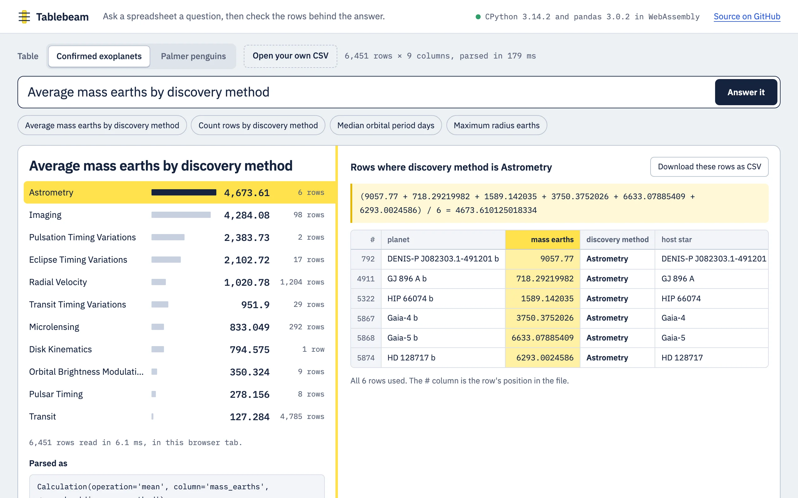

# Tablebeam

Tablebeam answers counts, totals, averages, medians, minimums and maximums over a CSV or a public Google Sheet. It reads every row with exact arithmetic and shows the rows behind each number. It runs on your computer, and a local model through LM Studio or Ollama is optional.

[](https://tablebeam-eight.vercel.app)

## Try it

The [live demo](https://tablebeam-eight.vercel.app) needs no install or account. It loads the app's own parser and calculation modules, copied unchanged from `src/`, into CPython and pandas running in WebAssembly. Your CSV stays in the browser tab. The runtime is about 19 MB on first load. The demo has no model, so questions outside the recognised forms get a note pointing to the desktop app.

## Run locally

```bash
git clone https://github.com/fortunexbt/tablebeam.git
cd tablebeam
./start.sh --demo
```

The launcher creates `.venv`, installs or updates what's missing and opens <http://localhost:8501>. On Windows, run `start.bat --demo`. `--skip-install` runs an existing environment without touching packages.

Ask in one of these forms, using your table's column names (spaces can stand in for underscores and dashes).

- `How many rows are there?`
- `Total annual revenue`
- `Average health score by status`
- `Count rows by owner`

Sum, average, median, minimum and maximum all work, with or without `by <column>`. **Build a calculation** adds filters and lets you pick the columns directly. Each answer shows the operation, how missing values were handled, the rows used and a CSV export of them.

A public Google Sheet loads from **Use a Google Sheet instead** once it's shared as "Anyone with the link". [Google Sheets guide](docs/guides/google-sheets.md).

## Local models

Anything the parser doesn't recognise is refused, with an **Ask AI** option. Open **AI settings**, pick LM Studio or Ollama, then **Find local models**. To point at another OpenAI-compatible server, set it before launch.

```bash
export LLM_BASE_URL=http://localhost:1234/v1
export LLM_MODEL=your-loaded-model
./start.sh
```

Set `LLM_API_KEY` if your server needs one. `./start.sh --ollama --demo` targets Ollama on its default port, and `--start-server` lets the launcher start the provider with its installed CLI. Tablebeam only downloads or loads a model when you click to. The model sees a sample of retrieved rows plus the table profile, not the whole table, so check its claims against the built-in calculations.

## How far to trust it

[`eval/`](eval/) tests the parser and calculations without any model. `python eval/run_eval.py` regenerates [`eval/results.md`](eval/results.md) byte for byte from inputs pinned by SHA-256, and that file lists every wrong answer.

On 554 [WikiTableQuestions](https://github.com/ppasupat/WikiTableQuestions) questions that are whole-table aggregates, with ground truth from [SQUALL](https://github.com/tzshi/squall)'s SQL run in DuckDB, Tablebeam answered 79.1% correctly, refused 20.6% and returned a wrong number for 0.4%. With their defaults, pandas, SQLite and DuckDB gave silently wrong results for 13.7%, 17.2% and 11.7%. On 162 calculations over four real CSVs with awkward number formats (19-digit IDs, `null` spelled out, comma decimals), Tablebeam made no errors and refused 37.0%, while the others were silently wrong on 19.8% to 38.9%.

The main limits:

- Typed questions only work in the documented forms. The parser accepted none of the 554 questions in their original wording.
- A table with its own Total row is detected by a heuristic, and single-number answers over it are refused.
- Comma decimals such as `18,1` are read as text, so averages over them are refused.
- Every executor ran with its defaults. Setting column types by hand would change their numbers.

`eval/results.md` has the intervals, the per-question results and the full rules for "correct".

## Privacy

Loading, calculating and exporting happen in the Tablebeam process. Loading a Google Sheet fetches it from Google. **Ask AI** sends the question, the selected rows and the table profile to the configured endpoint, which stays on your machine only if the endpoint does. The table lives in the session rather than a database, and Streamlit telemetry is off.

## API and Docker

`python src/api_server.py` serves `/health`, `/ready` and `POST /api/v1/query` for model questions over the file in `DATA_SOURCE`. The release image is `ghcr.io/fortunexbt/tablebeam:2.0.0`, which predates the changes under Unreleased in the [changelog](CHANGELOG.md).

```bash
docker run --rm -p 8501:8501 --add-host=host.docker.internal:host-gateway \
  -e LLM_BASE_URL=http://host.docker.internal:1234/v1 ghcr.io/fortunexbt/tablebeam:2.0.0
```

## Development

```bash
python -m pip install -r requirements-dev.txt
pytest -q
bash web/build.sh && python -m http.server 8000 -d web/dist
```

The tests use fake provider responses, so they need no model server. `tests/test_web_demo.py` fails if the demo's copied modules drift from `src/`.

## Data and licence

The demo bundles all 6,451 rows of the [NASA Exoplanet Archive](https://exoplanetarchive.ipac.caltech.edu/) Planetary Systems Composite Parameters table (`pscomppars`), retrieved 22 October 2026. This research has made use of the NASA Exoplanet Archive, which is operated by the California Institute of Technology, under contract with NASA under the Exoplanet Exploration Program. It also bundles `penguins.csv` from [palmerpenguins](https://allisonhorst.github.io/palmerpenguins/) by Horst, Hill and Gorman (CC0 1.0), collected by Dr. Kristen Gorman and the Palmer Station LTER. Both are unmodified apart from column names.

The evaluation uses WikiTableQuestions (Pasupat and Liang, 2015) and SQUALL (Shi et al., 2020), both CC BY-SA 4.0. It also uses the U.S. Treasury's [Debt to the Penny](https://fiscaldata.treasury.gov/datasets/debt-to-the-penny/) (public domain), Wikidata (CC0), and the 2022 Paris and 2023 Montpellier rent-control tables from data.gouv.fr (Licence Ouverte 2.0).

Tablebeam is MIT licensed. See [LICENSE](LICENSE).
