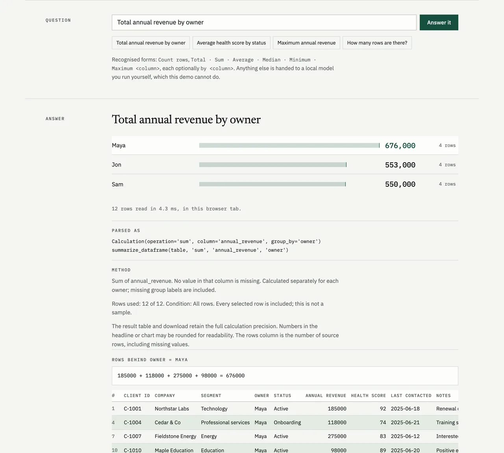

# Tablebeam

**Get answers from your spreadsheet.**

Open a CSV, choose a question, and see the answer. Totals and comparisons run on your computer. Connect [LM Studio](https://lmstudio.ai/) or [Ollama](https://ollama.com/) when you want an AI interpretation.

**Live demo: <https://tablebeam-eight.vercel.app>** — no install, no account, nothing uploaded.

[](https://tablebeam-eight.vercel.app)

[](https://github.com/fortunexbt/tablebeam/actions/workflows/test.yml)
[](LICENSE)

## Browser demo

The demo page runs the real thing. `web/build.sh` copies `src/answer_format.py`,
`src/data_pipeline.py`, `src/question_actions.py` and `src/table_analysis.py` into the
static output unchanged, and a module worker loads them into CPython 3.14 and pandas
3.0 compiled to WebAssembly. Your CSV is read in the tab and never uploaded. Every
answer shows what the question parsed to, the function call behind it, the written-out
arithmetic, and the rows used.

```bash
bash web/build.sh
python -m http.server 8000 -d web/dist
```

Limits: the runtime is about 19 MB on first load, then cached by the browser. The
optional AI path is not in the demo. Questions outside the recognised forms get a note
saying they run in the desktop app with a model you host yourself (LM Studio or Ollama);
the page never calls a model. `tests/test_web_demo.py` fails if the copied modules drift
from `src/`.

Bundled data, unmodified apart from column names:

- **Confirmed exoplanets**: all 6,451 rows of the
  [NASA Exoplanet Archive](https://exoplanetarchive.ipac.caltech.edu/) Planetary Systems
  Composite Parameters table (`pscomppars`), retrieved 22 October 2026 through its TAP
  service. This research has made use of the NASA Exoplanet Archive, which is operated by
  the California Institute of Technology, under contract with NASA under the Exoplanet
  Exploration Program.
- **Palmer penguins**: `penguins.csv` from
  [palmerpenguins](https://allisonhorst.github.io/palmerpenguins/) by Horst, Hill and
  Gorman, CC0 1.0. Data collected by Dr. Kristen Gorman and the Palmer Station LTER.

## Start

```bash
git clone https://github.com/fortunexbt/tablebeam.git
cd tablebeam
./start.sh --demo
```

The launcher creates `.venv`, checks installed dependency versions, installs or updates what is needed, and opens <http://localhost:8501>. Windows users can run `start.bat --demo`. No model or account is needed to try the example. Use `--skip-install` to check and run an existing environment without installing packages; missing or incompatible dependencies produce repair instructions.

1. Choose a suggested question, such as **Annual revenue by status**, or type **What is the total annual revenue?**
2. Read the number or chart, then **Download answer** if you want to keep it.
3. Use **Change table** to open your own CSV. Uploading opens it immediately. A failed import keeps your current table intact.

A public Google Sheet can be loaded from **Use a Google Sheet instead**. Share it as “Anyone with the link” first; opening it fetches its contents from Google.

## Ask a question

Straightforward, unambiguous calculations work without AI:

- `How many rows are there?`
- `Total annual revenue`
- `Average health score`
- `Annual revenue by status`
- `Count rows by owner`

Use your table’s actual column names; underscores and dashes can be written as spaces. Sum, average, median, minimum, and maximum are supported. Common forms such as “What is the total …?”, “Show me …”, and “Calculate …” work too.

The parser only accepts complete supported questions. It does not guess shortened column names, invent filters, or silently treat an ambiguous question as an exact calculation. Other wording offers an explicit **Ask AI** or **Connect AI** action.

## When you need more control

**Build a calculation** lets you choose the operation and columns directly, optionally comparing groups or limiting rows. Text conditions offer existing values where practical. Click **Calculate** when your choices are ready; changing a control does not silently change a completed answer.

Each new question starts from the full table. A filter belongs to the calculation that created it, and that answer shows the condition and row coverage. The previous five completed answers are available under **Previous answers**. Switching between answers preserves them; changing or clearing the table resets its questions, calculations, and history.

**How this was calculated** contains the exact operation, missing-value rules, result table, and row coverage. **View rows used** shows up to 50 rows and can export all contributing rows. **View data** previews the source and its quality notes.

Count includes every selected row. A single-number answer (other than a minimum) is refused when the table looks like it carries its own total row: a cell reading “Total”, “Totals” or “Grand total”, or a row whose value equals the sum of at least three other non-zero rows. Leave that row out with a condition and calculate again; a grouped answer shows it as its own group. Numeric operations ignore missing measures; entirely missing measures return “No values.” Missing group labels form their own group. The chart shows up to 20 groups, while the answer download includes all groups. Integer sums and integer filter thresholds preserve precision; charts omit integers beyond their precise numeric range, while result tables and downloads retain them. Floating-point calculations follow pandas arithmetic.

Explicit answer/row downloads are UTF-8 BOM CSV and neutralize formula-like text with an apostrophe prefix. Source row numbers refer to the loaded table after empty rows are removed. CSV files, uploads, and Google Sheets imports require unique nonempty headers, consistent record widths, UTF-8, at most 100 MB, and at most 250,000 rows. Integer columns retain every digit, including when some cells are empty.

## Evaluation

`eval/` measures the deterministic engine only: the CSV reader, the question parser and the calculations. It never loads or calls a model. `python eval/run_eval.py` regenerates [`eval/results.md`](eval/results.md), which lists every wrong answer and every executor disagreement, and `eval/results.json`, from inputs pinned by SHA-256 in `eval/inputs/manifest.json`. With the versions in `eval/requirements.txt`, a rerun produces byte-identical files. `eval/build_inputs.py` downloads the sources again and checks them.

Rates below are given with 95% Wilson intervals.

**Real questions.** The set has 954 questions from [WikiTableQuestions](https://github.com/ppasupat/WikiTableQuestions) (Pasupat and Liang, 2015, CC BY-SA 4.0), asked about tables taken from Wikipedia. 554 of them are whole-table counts, totals, averages, minimums or maximums, as identified by [SQUALL](https://github.com/tzshi/squall)'s hand-written SQL (Shi et al., 2020, CC BY-SA 4.0). The other 400 are a fixed sample of the remaining questions (filters, lookups, rankings), and for those a refusal is the correct outcome. The ground truth is SQUALL's SQL run in DuckDB over SQUALL's parsed columns. pandas recomputes it as a cross-check, and it is kept only when it matches the human WikiTableQuestions answer. That dropped 16 questions, which are listed in the results.

| Questions | n | Correct | Refused | Wrong |
|---|---|---|---|---|
| As people wrote them | 954 | 41.9% (38.8–45.1), all correct refusals | 100% (99.6–100) | 0.0% (0.0–0.4) |
| The 554 supported ones, in this README's wording | 554 | 79.1% (75.5–82.2) | 20.6% (17.4–24.1) | 0.4% (0.1–1.3) |
| The same, before the fixes below | 554 | 79.2% (75.7–82.4) | 14.6% (11.9–17.8) | 6.1% (4.4–8.5) |

The parser accepted none of the 554 supported questions in their original wording, such as "how many total gold medals were won?". A typed question only works in the documented forms. Before the fixes, 32 of the 34 wrong answers were sums, averages, maxima and counts that included the table's own Total or Career row. Those questions are now refused. The 114 refusals break down as: 54 columns that are text rather than numbers (`12,467`, `41 (2)`), 33 total rows, 14 blank headers and 13 duplicate headers.

**The same calculations in four executors.** Each supported question's calculation also ran in pandas (`read_csv`), in SQLite (imported as the sqlite3 shell's `.import` does, with every field stored as TEXT) and in DuckDB (`read_csv` auto-detection), each with its defaults. A second set of 162 calculations ran over four real CSVs whose number formats break readers. These are the U.S. Treasury's [Debt to the Penny](https://fiscaldata.treasury.gov/datasets/debt-to-the-penny/) (public domain; cents on 13-digit amounts, missing values spelled `null`), members of the 9th European Parliament with their X user IDs from Wikidata (CC0; 19-digit IDs and blanks), and the 2022 Paris and 2023 Montpellier rent-control tables from data.gouv.fr (Licence Ouverte 2.0; the Montpellier file writes decimals as `"18,1"`). That set is the exact reference: each cell is parsed as written and aggregated with exact fractions, and DuckDB's `DECIMAL` arithmetic cross-checks it. "Silent wrong" means a number came back wrong with no error.

| Executor | WikiTableQuestions: correct | silent wrong | refused | Hard-format CSVs: correct | silent wrong | refused |
|---|---|---|---|---|---|---|
| Tablebeam | 79.1% (75.5–82.2) | 0.4% (0.1–1.3) | 20.6% | 63.0% (55.3–70.0) | 0.0% (0.0–2.3) | 37.0% |
| pandas | 85.0% (81.8–87.8) | 13.7% (11.1–16.8) | 1.3% | 61.7% (54.0–68.9) | 19.8% (14.3–26.6) | 18.5% |
| SQLite | 80.5% (77.0–83.6) | 17.2% (14.2–20.5) | 2.4% | 38.9% (31.7–46.6) | 38.9% (31.7–46.6) | 22.2% |
| DuckDB | 84.5% (81.2–87.2) | 11.7% (9.3–14.7) | 3.8% | 54.9% (47.2–62.4) | 33.3% (26.5–40.9) | 11.7% |

Tablebeam returns fewer answers, and almost every answer it returns is right. Before the fixes its silent-wrong rate on WikiTableQuestions was 6.1% (4.4–8.5): lower than pandas, but not zero. The other executors fail in these ways:

- SQLite compares text, so the minimum X user ID comes back as the empty string. It also averages `null` and `"18,1"` as 0 and 18.
- pandas reads an ID column that has blanks as float64 and loses the last digits above 2^53. Asked for the maximum of `"18,1"` text, it returns a string.
- DuckDB reads the columns that contain `null` or `"18,1"` as VARCHAR, then returns their alphabetical minimum and maximum.

Tablebeam refuses every average, median, minimum and maximum over Montpellier's comma decimals (60 calculations), because it does not read `18,1` as a number.

**Provenance.** For each of the 542 answers Tablebeam returned, the evaluation checks that the displayed rows, the downloaded rows, the scope ("All rows" or one group) and the written-out arithmetic all reproduce the number. It also checks that the six-digit figure shown matches the exact value rounded. Before the fixes, 4 provenance checks and 3 displayed figures failed. Now none do.

Fixed during this evaluation, each with a regression test:

- Total rows are refused as described in [Ask a question](#ask-a-question).
- In the browser demo, TRUE/FALSE group labels showed as 1 and 0.
- Displayed values that end in a 5 at the seventh significant digit rounded the wrong way, for example 32.36875 shown as 32.3687.

Limits:

- Two thirds of the 554 supported questions are row counts, and only 16 are averages.
- WikiTableQuestions ships its CSVs with backslash-escaped quotes. The pinned copies are re-quoted to standard CSV with every value unchanged, because Tablebeam and Python's `csv` module reject the originals.
- The Wikidata and Treasury files are snapshots from 23 October 2026.
- Every executor runs with its defaults. An analyst who sets column types or a decimal separator would get other numbers. That difference is the point of the comparison, and it is also its limit.
- "Correct" accepts float noise. Counts, totals, minimums and maximums must be right to the data's last decimal, and averages and medians to within one part in 10^12. Full rules are in `eval/executors.py`.
- The total-row check is a heuristic. On this data it refused one count that the ground truth expected to include the total row.
- Related benchmarks (TrustDABench, arXiv 2608.24145; FREB-TQA, arXiv 2404.18585; RobuT, arXiv 2306.14321) perturb tables and questions to test models. Their abstracts don't describe comparing executors' number handling like this, but only the abstracts were checked.

## Connect AI only when you need it

Open **AI settings**, choose LM Studio or Ollama, and click **Find local models**. Select a ready model, then return to your question and choose **Ask AI**. LM Studio reports which models are loaded; an unloaded model can be explicitly loaded. Ollama can use an installed model and loads it when asked. Tablebeam does not automatically download a model or turn unsupported wording into a generated answer.

AI sees a retrieved row sample plus the table profile, not necessarily every record. Its answer shows coverage, and **Check the sources** contains the exact rows and profile supplied to the model. The Markdown download keeps that evidence. AI claims should be checked; use built-in calculations for exact numbers.

For automatic provider startup, opt in with `./start.sh --demo --start-server`. This uses the installed provider CLI, never installs software, and accepts the older `--start-model` alias. Installer diagnostics are available with `TABLEBEAM_PIP_VERBOSE=1`.

## Use another local server

Ollama exposes the same API shape:

```bash
ollama serve
ollama pull llama3.2
./start.sh --ollama --demo
```

Any compatible endpoint can be configured directly:

```bash
export LLM_BASE_URL=http://localhost:1234/v1
export LLM_MODEL=your-loaded-model
./start.sh
```

LM Studio and Ollama normally need no API key. If your server requires one, set `LLM_API_KEY` or enter it in **AI settings → Advanced settings**.

Open **AI settings → Find local models** to discover the selected server. Server address, API key, and a custom model ID are under **Advanced settings**. Configured `LLM_BASE_URL` and `LLM_MODEL` are preserved, and closing settings does not discard them. Discovery uses LM Studio's native model API or Ollama's `/api/tags` and `/api/ps`; compatible servers can fall back to `/v1/models`, which reports availability rather than loaded state. Explicit local start/load actions use `lms server start`, `lms load`, `ollama serve`, or `ollama pull`. For a server on another host, Tablebeam gives instructions to manage it there. `--start-model` remains accepted as a backwards-compatible alias for `--start-server`.

## Optional API

The web app is the primary interface. For scripts or local integrations, start the optional API with an explicit source:

```bash
export DATA_SOURCE=/absolute/path/to/data.csv
export LLM_BASE_URL=http://localhost:1234/v1
export LLM_MODEL=your-loaded-model
python src/api_server.py
```

It exposes `/health`, `/ready`, and `POST /api/v1/query` for model Q&A. It never downloads a model and remains unavailable for queries until `DATA_SOURCE` is set. The web interface’s built-in question parser and calculation builder are separate from this model-only endpoint.

## Docker

Run the published multi-architecture release image (2.0.0 predates the unreleased interface changes below):

```bash
docker run --rm -p 8501:8501 \
  --add-host=host.docker.internal:host-gateway \
  -e LLM_BASE_URL=http://host.docker.internal:1234/v1 \
  ghcr.io/fortunexbt/tablebeam:2.0.0
```

Or build it locally:

```bash
docker build -t tablebeam .
docker run --rm -p 8501:8501 \
  --add-host=host.docker.internal:host-gateway \
  -e LLM_BASE_URL=http://host.docker.internal:1234/v1 \
  tablebeam
```

Start LM Studio on the host first. The container runs as a non-root user and does not package models or persistent data.
The image includes a Streamlit health check at `/_stcore/health`.

## Development

```bash
python -m pip install -r requirements-dev.txt
pytest -q
python -m py_compile src/*.py
bash -n start.sh web/build.sh
```

Tests cover CSV boundaries, conservative question parsing, exact calculations, safe result rendering, provider responses, FastAPI behavior, complete Streamlit workflows, and the browser demo's copy of the engine. They use fake provider responses and require no LM Studio or Ollama. CI runs Python 3.10–3.12.

See [the changelog](CHANGELOG.md) for the current changes.

## Privacy

CSV ingestion, built-in calculations, evidence previews, and exports run in the Tablebeam process. Loading a public Google Sheet fetches it from Google. **Ask AI** sends the question, selected rows, and deterministic profile to the configured endpoint. Use a local endpoint to keep that context on your machine; a remote endpoint receives it. Provider checks and explicit start/load actions contact the selected provider. No connection is probed automatically during normal exploration, and Streamlit usage telemetry is disabled in the project configuration.

The table is session-scoped, not written to a database. Browser downloads are saved by you. Check your model server’s logging and retention settings for stricter privacy requirements.

MIT licensed. See [LICENSE](LICENSE).
